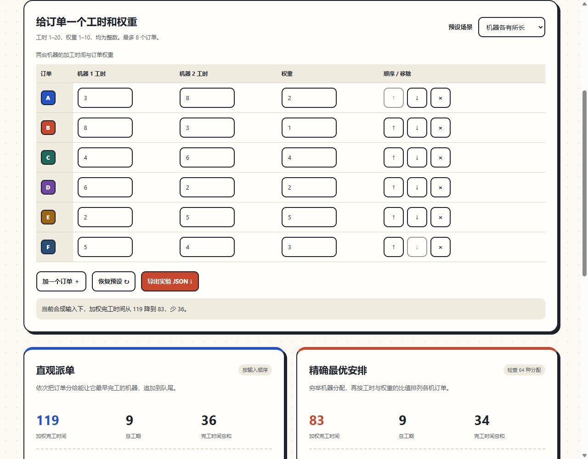

# 工程优化小例 · 双机调度实验室

**同一批订单，换一种安排。** 把订单分给两台机器，调整加工时间与优先权重，用甘特图比较直观派单与精确最优方案。

[在线体验](https://hea1.org/engineering-optimization-examples/) · [设计笔记](https://hea1.org/notes/scheduling-priorities/) · [模型与验证](docs/model.md) · [hea1 的小站](https://hea1.org/)



这个仓库从一个小型调度例子开始。纯 JavaScript，界面、规则、数据与测试分开；无框架、付费求解器或依赖安装。

## 可以试什么

- 修改每个订单在两台机器上的工时（1–20）和权重（1–10），结果自动重算。
- 调整输入顺序，增删订单（1–8个），切换三个合成预设。
- 对比按输入顺序的最早完工贪心派单与精确最优安排。
- 查看同一时间刻度下的甘特图、每单开始/完工时间、权重和代价。
- 导出 JSON，并用命令行或纯模块重新计算。

默认例子的结果：

| 方案 | 加权完工时间 ΣwC | 总工期 | 完工时间总和 |
| --- | ---: | ---: | ---: |
| 直观派单 | 119 | 9 | 36 |
| 精确最优 | 83 | 9 | 34 |

这些数来自仓库的固定合成输入，不是课程原题、现场订单或企业绩效。把 F 的权重改成10，最优方案会把它移到机器2的最前面；你也可以改变工时，观察分配是否变化。

## 本地运行

安装 Node.js 22+，在仓库目录执行，无须 `npm install`：

```sh
node scripts/serve.mjs
# 打开 http://127.0.0.1:8785/
node --test
node scripts/build.mjs
```

本机服务只监听回环地址；Ctrl+C停止，端口可通过 `PORT` 环境变量设置。`dist/`是明确文件清单构成的静态发布目录。也可使用 `npm start`、`npm test`、`npm run build`。

命令行直接解固定例子，或复核从网页导出的文件：

```sh
node scripts/solve.mjs
node scripts/solve.mjs scheduling-experiment.json
```

`solve.mjs`接受含 `jobs` 数组的JSON，向标准输出写两种安排。也可直接调用：

```js
import { createPreset, compareSchedules } from './scheduling.mjs';
console.log(compareSchedules(createPreset('specialists')));
```

## 为什么可以叫“精确最优”

目标是最小化所有订单的 `权重 × 完工时间` 之和。所有订单在时刻0可用，2台机器并行，同机加工不能重叠，不能中断，工时固定且可以因机器而异。

穷举每个订单的机器分配，最多 `2^8 = 256` 种。确定每台机器有哪些订单后，按该机 `工时/权重` 的非降序排列（Smith规则）。用相邻交换即可证明这个顺序最优，所以在上述小模型内得到全局最优。完整推导与独立基准见[模型与验证](docs/model.md)。

8组自动检查包含3预设、60组固定种子随机输入、独立全排列/分割基准、非重叠、指标复算、极值、非法输入、不修改数据与JSON复现。特定Chromium环境中核对桌面、390px/320px、键盘、编辑/排序/增删/错误反馈与导出；并非所有设备认证。

## 解释范围与来源

这是2026年11月为 hea1.org 新实现的AI辅助教学例子，选题来自工程优化中的订单调度结构，使用全新合成数据，不公开课程题目或答案，不承接旧结果。

“最优”只针对列出的模型与加权完工目标；总工期不一定下降。没有交期、释放时间、切换耗时、设备故障、订单依赖或中断，不是生产排程软件或企业效果研究。

应用只在页面内计算，不设置账户、远程模型、分析埋点或浏览器存储；托管方仍可能保留普通访问日志。开发、文档与验证使用 Codex 辅助，不声称维护者独立完成全部开发或开展真人研究。代码与文档采用 [MIT](LICENSE)，没有第三方运行库。

## English

A reproducible two-machine scheduling teaching example. Edit synthetic processing times, job priorities and input order; compare a simple dispatch heuristic against exact assignment enumeration with Smith ordering. Inspect Gantt charts, per-job metrics and JSON replay. Node.js 22+ runs the demo, tests and CLI without installing dependencies. AI-assisted educational implementation with explicit model limits.
